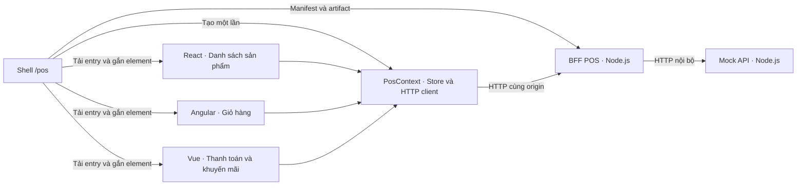

# Kế hoạch xây dựng POS bằng micro frontend

## 1. Bối cảnh và mục tiêu

Xây dựng màn hình `/pos` cho nhân viên thu ngân. Trên cùng một trang, nhân viên tìm sản phẩm, thêm vào giỏ, điều chỉnh số lượng, áp dụng khuyến mãi, chọn cách thanh toán và nhận xác nhận giao dịch. Đây là demo tập trung vào frontend. Backend for Frontend (BFF) phục vụ ứng dụng POS và chuyển tiếp các yêu cầu HTTP đến backend giả lập, nơi cung cấp dữ liệu sản phẩm và kiểm tra giao dịch.

Ba nhóm lần lượt phụ trách Danh sách sản phẩm (React), Giỏ hàng (Angular), và Thanh toán & khuyến mãi (Vue). Shell và hợp đồng tích hợp là phần việc chung. Phạm vi MVP gồm một quầy, một giỏ đang thao tác, một mã giảm giá, tiền VND và hai phương thức thanh toán mô phỏng. Tài khoản, quản lý tồn kho, đồng bộ nhiều quầy, cổng thanh toán thật, in hóa đơn và lưu lịch sử giao dịch lâu dài nằm ngoài MVP.

## 2. Nghiên cứu và quyết định kiến trúc

- Micro frontend chia giao diện theo chức năng nghiệp vụ mà các nhóm có thể phát triển và phát hành độc lập. Với POS, ba chức năng xuất hiện đồng thời, nên shell bố trí ba vùng trên cùng route và ghép các bản build lúc trình duyệt chạy. [Micro Frontends — Cameron Jackson](https://martinfowler.com/articles/micro-frontends.html)
- Dùng **Custom Elements + ES modules**. Shell tải entry bằng `import(url)`, nhận phần tử HTML do micro app đăng ký và gắn vào vùng đã dành sẵn. Cơ chế này giữ được hợp đồng DOM chung cho ba framework và dùng được Angular CLI với AOT. [HTML Standard — Custom elements](https://html.spec.whatwg.org/multipage/custom-elements.html), [Angular — Custom Elements](https://angular.dev/guide/elements), [Angular — Application build system](https://angular.dev/tools/cli/build-system-migration)
- single-spa cung cấp lifecycle và cơ chế xác định app nào hoạt động theo route. Shell POS chỉ điều phối ba vùng cố định, nên dùng trực tiếp lifecycle của Custom Elements. Chi phí cần kiểm tra là tải ba runtime, đồng bộ hợp đồng dữ liệu và xử lý lỗi tải từng app. [single-spa — Configuring applications](https://single-spa.js.org/docs/configuration/), [Micro Frontends — Downsides](https://martinfowler.com/articles/micro-frontends.html#Downsides)
- Dùng một BFF mỏng cho màn hình POS. Trình duyệt tải shell, artifact và gọi API từ cùng origin. Mock API chạy riêng để có thể kiểm thử trực tiếp quy tắc giao dịch qua HTTP.

## 3. Kiến trúc và quyền sở hữu

| Thành phần | Công nghệ | Trách nhiệm |
| --- | --- | --- |
| `apps/shell` | TypeScript, Vite | Route `/pos`, bố cục, manifest, tải và gỡ các micro app, tạo store và HTTP client, hiển thị lỗi tích hợp theo vùng |
| `apps/catalog` | React 19, Vite | `<pos-catalog>`. Tải, tìm kiếm và hiển thị sản phẩm. Gửi yêu cầu thêm vào giỏ |
| `apps/cart` | Angular 21, Angular CLI, Angular Elements | `<pos-cart>`. Hiển thị dòng hàng, số lượng, tạm tính và thao tác sửa giỏ |
| `apps/checkout` | Vue 3.5+, Vite | `<pos-checkout>`. Nhập mã, chọn phương thức, xác nhận và hiển thị kết quả thanh toán |
| `packages/pos-domain` | TypeScript thuần | Kiểu dữ liệu, hợp đồng tích hợp và hàm tính tiền thuần để shell và mock API tính nhất quán |
| `services/bff` | Node.js | Phục vụ shell tại `/pos`, manifest và artifact frontend. Chuyển tiếp API POS tới địa chỉ mock API cấu hình ở server |
| `services/mock-api` | Node.js | Phục vụ fixture sản phẩm, kiểm tra yêu cầu, tính tiền và lưu giao dịch trong bộ nhớ. Chạy riêng để phục vụ demo và kiểm thử HTTP |

### Build, tải và vòng đời

1. Khởi tạo npm workspaces và lockfile chung. Dùng Node 24.x và TypeScript 5.9.x cho Angular 21. Ghim Angular Core và Elements cùng phiên bản, chọn CLI tương thích, đồng thời kiểm tra yêu cầu phiên bản của Vite và các plugin trước khi chốt lockfile. [Angular — Version compatibility](https://angular.dev/reference/versions)
2. Mỗi micro app có lệnh build và trang preview riêng chạy với `PosContext` giả. React và Vue xuất entry ESM bằng Vite library mode và bundle runtime của mình. React dùng `createRoot` trong Shadow DOM, gọi `root.unmount()` khi element bị gỡ, và nạp CSS vào shadow root với `?inline`. Vue sử dụng `defineCustomElement` với `.ce.vue` để đóng gói CSS và xử lý vòng đời. Angular dùng `createApplication`, `createCustomElement` và `ViewEncapsulation.ShadowDom`. Dùng cấu hình zoneless mặc định của Angular 21 và CSS cấp component để entry tích hợp chỉ cần JS cùng các chunk phụ thuộc. [Vite — Library mode](https://vite.dev/guide/build.html#library-mode), [Vite — CSS](https://vite.dev/guide/features.html#css), [React — createRoot](https://react.dev/reference/react-dom/client/createRoot), [Vue — Web Components](https://vuejs.org/guide/extras/web-components.html), [Angular — createApplication](https://angular.dev/api/platform-browser/createApplication), [Angular — Zoneless](https://angular.dev/guide/zoneless)
3. BFF phục vụ đầy đủ artifact dưới thư mục có phiên bản, ví dụ `/mfe/cart/1.0.0/main.js`. Dùng `outputHashing: none` cho demo Angular để có entry ổn định trong mỗi thư mục phiên bản. Manifest `/mfe-manifest.json` được phục vụ riêng với bundle shell, ánh xạ từng app tới `{ tag, entry, contractVersion }`. Entry và chunk cần đúng kiểu MIME JavaScript. Demo dùng origin của BFF cho shell, artifact và API. [Angular — Build options](https://angular.dev/cli/build), [Angular — Deployment](https://angular.dev/tools/cli/deployment)
4. Shell tải manifest khi mở trang, kiểm tra `contractVersion: 1` rồi tải ba module song song. Với từng app, shell đợi import và `customElements.whenDefined(tag)` trong thời gian giới hạn, tạo element, gán `posContext` qua thuộc tính JavaScript trước khi gắn vào DOM. Hiển thị trạng thái đang tải và fallback riêng nếu entry lỗi, đăng ký quá hạn hoặc hợp đồng không tương thích. Mỗi lần gắn lại tạo element mới. Micro app dọn subscription và yêu cầu đọc dữ liệu đang chạy khi bị gỡ. [HTML Standard — CustomElementRegistry](https://html.spec.whatwg.org/multipage/custom-elements.html#the-customelementregistry-interface), [Angular — Custom Elements, limitations](https://angular.dev/guide/elements#limitations)
5. Phát hành bản tương thích bằng cách đưa bản build vào thư mục phiên bản mới và cập nhật entry tương ứng trong manifest. Mở lại trang để dùng phiên bản mới. Có thể quay về entry cũ bằng cùng thao tác. Shell chỉ phụ thuộc hợp đồng chung và URL cấu hình. Các micro app chỉ sử dụng hợp đồng công khai, qua đó mỗi nhóm tự build và kiểm thử phần mình.

### Hợp đồng tích hợp v1

Adapter Angular khai báo input `posContext` và dùng selector nội bộ khác tên tag `pos-cart`. Adapter Vue khai báo prop đối tượng `posContext`. Hai nhóm kiểm tra ngay ở mốc 1 rằng giá trị gán qua DOM property trước khi gắn được nhận trong component và subscription được dọn khi hủy. [Angular — Custom Elements](https://angular.dev/guide/elements), [Vue — Web Components](https://vuejs.org/guide/extras/web-components.html)

| Giao diện | Nội dung |
| --- | --- |
| `posContext.version` | Giá trị `1`. Khai báo property tương ứng trong adapter của từng framework |
| DOM event `pos-ready` | Remote phát trên chính custom element, một lần cho mỗi instance, sau khi nhận `posContext` hợp lệ, thiết lập subscription cần thiết và hoàn tất lần render đầu tiên. UI đang tải dữ liệu vẫn có thể báo sẵn sàng |
| DOM event `pos-fatal` | Remote phát trên chính custom element khi instance không thể khởi tạo hoặc tiếp tục hoạt động. `detail` gồm `{ phase: 'init' \| 'runtime', code: string }`. Dùng `init` trước khi báo sẵn sàng và `runtime` sau đó |
| `catalog.list(signal?)` | Trả về danh sách `Product` từ mock API qua BFF. Catalog tự quản lý tìm kiếm, trạng thái tải và thử lại |
| `getSnapshot()` | Trả về snapshot chỉ đọc gồm `lines`, mã đã áp dụng, tạm tính, giảm giá, tổng phải trả và trạng thái giao dịch. Giữ nguyên tham chiếu đến khi state đổi |
| `subscribe(listener)` | Đăng ký callback khi có snapshot mới và trả về hàm hủy. Angular cập nhật signal, Vue cập nhật `shallowRef`. React có thể dùng `useSyncExternalStore` khi cần đọc state |
| `addItem(product)`, `setQuantity(productId, quantity)`, `removeItem(productId)` | Catalog gọi `addItem`. Giỏ hàng gọi hai lệnh còn lại. Shell kiểm tra điều kiện trước khi cập nhật |
| `applyPromo(code)`, `clearPromo()`, `submitCheckout(input)`, `retryCheckout()`, `startNewSale()` | Vue gọi khi người dùng thao tác. Lệnh trả kết quả thành công hoặc mã lỗi có kiểu để UI hiển thị |

- `Product` có `id`, `sku`, `name`, `unitPriceVnd`. Dòng giỏ có `productId`, tên, đơn giá và số lượng. Add cùng ID tăng số lượng trên một dòng. Số lượng hợp lệ là số nguyên từ 1 đến 99. Xóa dòng bằng nút riêng.
- Shell giữ một store trong bộ nhớ cho phiên mở trang, phát snapshot mới sau mỗi cập nhật hợp lệ. Catalog giữ từ khóa tìm kiếm và Vue giữ bản nháp form của mình. Giá trị giỏ, mã đã áp dụng và tiến trình checkout được đọc từ snapshot. Tải lại trang bắt đầu phiên mới.
- Tạm tính là tổng đơn giá nhân số lượng. Mã `GIAM10` giảm 10% khi tạm tính từ 100.000 ₫, chuẩn hóa chữ hoa và bỏ khoảng trắng đầu cuối. Chỉ áp dụng một mã. Giảm giá làm tròn xuống đến đồng, tổng phải trả bằng tạm tính trừ giảm giá. Khi thay đổi giỏ làm mất điều kiện, shell gỡ mã và Vue thông báo. Định dạng hiển thị dùng `Intl.NumberFormat('vi-VN', { style: 'currency', currency: 'VND' })`.
- Khi gửi yêu cầu, shell chụp payload và khóa thao tác thay đổi đơn. API xác nhận thành công thì shell lưu biên nhận và xóa giỏ cùng mã giảm. Nút **Đơn mới** dọn biên nhận và mở lại quy trình. API từ chối dứt khoát thì giữ giỏ để sửa. Nếu timeout, mất mạng hoặc gặp 5xx chưa rõ kết quả, giữ bản chụp và cho thử lại cùng khóa giao dịch trước khi cho sửa đơn.

### Ranh giới lỗi

| Giai đoạn | Trách nhiệm và cách xử lý |
| --- | --- |
| Tải và đăng ký | Shell hiển thị fallback của vùng tương ứng nếu cấu hình của remote sai, contract sai phiên bản, entry hoặc chunk cần cho import bị lỗi, hoặc quá 10 giây để tải module và đăng ký tag. |
| Khởi tạo và render đầu tiên | Shell gắn listener trực tiếp lên element trước khi gán `posContext` và bắt đầu thời hạn khởi tạo 10 giây ngay trước khi gắn DOM. Vùng giữ trạng thái đang tải đến khi nhận `pos-ready`. Shell chuyển sang fallback nếu nhận `pos-fatal`, tạo element hoặc gán property thất bại, hoặc hết thời hạn chờ `pos-ready`. `whenDefined()` chỉ xác nhận tag đã được đăng ký. |
| Lỗi làm vùng ngừng hoạt động sau khi sẵn sàng | Adapter bắt lỗi tại ranh giới của framework và báo `pos-fatal`. React dùng `onUncaughtError` trên root của element hoặc Error Boundary báo lỗi lên adapter. Angular dùng `ErrorHandler` của ứng dụng giỏ hàng cho lỗi framework chuyển đến. Vue dùng `app.config.errorHandler` qua `configureApp` của custom element. Adapter xử lý riêng lỗi trong thao tác khởi tạo, event handler và promise do mình gọi. Chỉ báo lỗi nghiêm trọng khi lỗi thuộc instance đó và vùng không thể tiếp tục. [React — createRoot](https://react.dev/reference/react-dom/client/createRoot) · [Angular — Unhandled errors](https://angular.dev/best-practices/error-handling) · [Vue — Custom Elements API](https://vuejs.org/api/custom-elements.html) |
| Lỗi có thể phục hồi | Remote hiển thị lỗi API hoặc lỗi nghiệp vụ tại nơi thao tác. Catalog thử lại tải sản phẩm trong vùng catalog. Checkout hiển thị lý do từ chối hoặc nút thử lại theo trạng thái giao dịch trong store. Các trường hợp này được xử lý trong UI của remote. |

- Shell chỉ xử lý tín hiệu từ instance hiện tại của vùng. Khi lỗi nghiêm trọng hoặc hết hạn, shell hủy bộ đếm, bỏ listener, gỡ element và hiển thị fallback của vùng. Kết quả import hoặc sự kiện đến muộn từ lần gắn đã kết thúc bị bỏ qua. Remote hủy subscription, timer và request đọc của instance khi bị gỡ, kể cả khi khởi tạo mới hoàn tất một phần.
- Sau lỗi khởi tạo hoặc render, nút **Thử lại** tạo element mới nếu module và tag đã sẵn sàng, dùng lại `posContext` và đọc snapshot hiện tại. Với lỗi tải artifact hoặc sai contract, fallback hướng dẫn tải lại trang sau khi nguồn phát hành được khôi phục. Thử lại vùng checkout chỉ gắn lại UI. Giao dịch đang gửi hoặc chưa rõ kết quả vẫn do shell quản lý và chỉ gửi lại theo lệnh `retryCheckout()` với khóa giao dịch cũ.
- Shell cô lập lỗi của từng subscriber khi phát snapshot. Nếu callback lỗi, các subscriber khác vẫn nhận cùng bản cập nhật. Remote chịu trách nhiệm bắt lỗi của callback mình đăng ký và báo lỗi nếu vùng cần được thay bằng fallback.
- Ranh giới trên áp dụng cho lỗi quy được về từng remote. Lỗi toàn cục chưa xác định được nguồn chỉ dùng để chẩn đoán. Shadow DOM cô lập CSS của component. Ba remote vẫn dùng chung luồng chính, nên một vòng lặp JavaScript đồng bộ kéo dài có thể làm cả trang treo.

## 4. Yêu cầu giao diện

| Khu vực | Việc cần hoàn thành |
| --- | --- |
| Shell | Màn hình rộng hiển thị ba cột theo thứ tự sản phẩm → giỏ → thanh toán. Màn hình hẹp xếp một cột cùng thứ tự, với các vùng vẫn hiện diện và không tràn ngang |
| Danh sách sản phẩm | Hiển thị tên, SKU và đơn giá. Tìm theo tên hoặc SKU, bỏ qua hoa thường. Có nút **Thêm vào giỏ**, trạng thái đang tải, không có kết quả, lỗi API và nút thử lại |
| Giỏ hàng | Hiển thị từng dòng với đơn giá, số lượng và thành tiền. Nút tăng, giảm, xóa, tạm tính và thông báo giỏ trống. Giới hạn số lượng và khóa sửa theo trạng thái giao dịch |
| Thanh toán và khuyến mãi | Hiển thị tạm tính, giảm giá, tổng phải trả. Nhập, áp dụng và gỡ mã, báo lỗi ngay cạnh trường. Chọn **Tiền mặt** hoặc **Thẻ mô phỏng**, sau đó xác nhận. Tiền mặt yêu cầu số tiền nhận đủ và hiển thị tiền thừa. Thẻ mô phỏng chỉ yêu cầu chọn phương thức |
| Kết quả | Hiển thị đang xử lý, lý do từ chối hoặc nút thử lại khi kết quả chưa rõ. Khi thành công, hiển thị mã giao dịch, số tiền, phương thức và tiền thừa nếu có |

Shell đặt font và CSS custom properties cho màu, khoảng cách và focus. Mỗi app giữ CSS trong Shadow DOM. Dùng button và input có nhãn, focus nhìn thấy được, thứ tự Tab theo luồng làm việc, và vùng thông báo `aria-live` cho cập nhật giỏ hoặc kết quả thanh toán.

## 5. BFF, mock API và hợp đồng HTTP

Shell dùng URL tương đối. BFF chỉ chuyển tiếp hai cặp method và path dưới đây đến cùng endpoint trên mock API. Demo chạy BFF tại `localhost:8080` và mock API tại `127.0.0.1:8081`. `npm run start` khởi động cả hai.

| Endpoint | Yêu cầu và phản hồi |
| --- | --- |
| `GET /api/products` | `200` trả `{ products }` từ fixture cố định, có SKU và giá đủ để thử ngưỡng khuyến mãi |
| `POST /api/checkout` | Header `Idempotency-Key`. Body gồm `items: [{ productId, quantity }]`, `promoCode` hoặc `null`, `paymentMethod: 'cash' \| 'mock-card'` và `cashReceivedVnd` khi dùng tiền mặt. `201` trả `{ orderId, subtotalVnd, discountVnd, totalVnd, paymentMethod, changeVnd }` với `changeVnd` là `null` cho thẻ |

**BFF.** Chuyển tiếp body JSON và `Idempotency-Key` từ shell, trả lại status và body từ mock API. Nếu không nhận được phản hồi hợp lệ từ mock API, BFF trả `502`, hoặc `504` nếu hết thời hạn chờ. Cả hai dùng định dạng `{ code, message }`. Shell coi các lỗi này trong checkout là kết quả chưa rõ và cho thử lại cùng khóa. BFF chỉ gửi một yêu cầu tới mock API cho mỗi lần gọi checkout.

**Mock API.** Mock chạy độc lập, dùng fixture cố định và lưu giao dịch trong bộ nhớ. Có thể dùng `node:http` cho cả hai service. [Node.js — HTTP](https://nodejs.org/api/http.html)

- Server kiểm tra giỏ trống, ID lạ, ID lặp, số lượng, phương thức, tiền nhận và mã giảm. Server lấy giá từ fixture, tính lại toàn bộ số tiền và trả `400` cho body sai cấu trúc hoặc `422` cho lỗi nghiệp vụ. Lỗi trả `{ code, message }`. Thẻ demo có kịch bản từ chối xác định để kiểm thử.
- Lưu kết quả thành công theo khóa trong một tiến trình. Cùng khóa và cùng payload trả lại biên nhận cũ. Cùng khóa với payload khác trả `409`. Xử lý ghi và kiểm tra khóa trong một đoạn đồng bộ sau khi đọc xong request để hai request cùng khóa chỉ tạo một giao dịch. Fixture và giao dịch đều có thể đặt lại bằng cách khởi động lại server thử nghiệm.
- Dùng `MOCK_CARD_RESULT=declined` khi khởi động mock server để tạo ca từ chối thẻ. Trong bài kiểm thử trình duyệt, chặn request catalog để thử trạng thái lỗi hoặc cho request checkout đi qua BFF đến mock API rồi hủy phản hồi đầu tiên để kiểm tra thử lại.

## 6. Các mốc triển khai

| Mốc | Việc cần làm | Điều kiện qua mốc |
| --- | --- | --- |
| 1. Kiểm tra tích hợp | Chốt workspace, công cụ và hợp đồng v1. Dựng shell với ba vùng, ba element hiển thị nội dung mẫu, các lệnh build riêng và BFF phục vụ manifest cùng artifact | Demo tại `/pos` tải đồng thời ba bản build, gồm entry AOT của Angular và toàn bộ chunk. Mỗi app chạy preview riêng. Cả ba adapter báo sẵn sàng sau lần render đầu tiên và báo lỗi render do framework xử lý. Có thể gỡ rồi gắn instance mới |
| 2. Giỏ và sản phẩm | Thêm fixture và API danh sách trong mock, chuyển tiếp route qua BFF, dựng store và hàm tính tiền. Nhóm React và Angular làm song song với context giả rồi tích hợp | Catalog tải dữ liệu qua BFF. Thêm sản phẩm từ React cập nhật giỏ Angular. Sửa giỏ cập nhật snapshot trong cùng phiên |
| 3. Khuyến mãi và checkout | Nhóm Vue dựng form theo hợp đồng. Tích hợp promo và API checkout qua BFF, trạng thái gửi, biên nhận và thử lại | Hoàn thành giao dịch qua UI, tổng tiền khớp phản hồi API, giỏ giữ nguyên ở ca lỗi dứt khoát |
| 4. Hoàn thiện và bàn giao | Bổ sung bố cục responsive, thao tác bàn phím, fallback, kiểm thử và README hướng dẫn demo | Đạt các tiêu chí nghiệm thu và tái hiện được từ bản checkout sạch |

## 7. Tiêu chí nghiệm thu

- [x] **Chạy từ bản checkout sạch.** `npm ci`, `npm run build`, `npm run start` mở được demo tại `http://localhost:8080/pos`. README có lệnh build và preview từng app, chạy kiểm thử, dữ liệu mẫu và cách đổi phiên bản entry.
- [x] **Luồng BFF.** Trình duyệt gọi cả hai endpoint cùng origin với shell. Kiểm thử HTTP xác nhận BFF chuyển tiếp `Idempotency-Key`, giữ nguyên status và body từ mock API và trả `502` khi mock API không truy cập được hoặc `504` khi hết hạn chờ. Kiểm thử quy tắc nghiệp vụ gọi mock API trực tiếp.
- [x] **Tách đúng kiến trúc.** Mạng trình duyệt ghi nhận ba entry ESM tương ứng ba artifact riêng. React, Angular và Vue cùng hoạt động trong một tài liệu HTML. Đổi riêng URL bản build catalog tương thích trong manifest và tải lại trang hiển thị đúng bản mới, với artifact shell, cart và checkout giữ nguyên.
- [x] **Vòng đời và cô lập lỗi.** Gỡ rồi gắn lại một vùng bằng element mới, mỗi thao tác sau đó chỉ cập nhật giỏ một lần. Khi entry checkout trả 404 hoặc sai phiên bản hợp đồng, shell báo lỗi ở vùng checkout và vẫn thêm, sửa giỏ được. CSS của từng app không ảnh hưởng vùng khác.
- [x] **Lỗi sau khi đăng ký.** Trên bản build tích hợp, kiểm tra trường hợp checkout đăng ký tag nhưng không báo sẵn sàng, lỗi khi render lần đầu và lỗi render sau khi đã sẵn sàng. Mỗi ca chỉ thay vùng checkout bằng fallback. Khi lỗi render được gỡ, thử lại vùng khôi phục UI từ snapshot hiện tại. Tín hiệu muộn từ instance cũ không đổi trạng thái vùng. Nếu một subscriber ném lỗi, các subscriber còn lại vẫn nhận snapshot.
- [x] **Luồng bán hàng.** Tìm đúng sản phẩm theo tên hoặc SKU. Thêm hai lần sản phẩm giá 50.000 ₫ tạo một dòng số lượng 2. Áp `GIAM10` cho tổng 100.000 ₫ hiển thị giảm 10.000 ₫ và còn 90.000 ₫. Giảm số lượng xuống 1 gỡ mã, cập nhật tổng về 50.000 ₫ và báo lý do. Có thể xóa dòng về giỏ trống.
- [x] **Thanh toán.** Tổng 90.000 ₫, nhận 100.000 ₫ tiền mặt, hiển thị tiền thừa 10.000 ₫. Biên nhận có mã giao dịch và giỏ được dọn sau thành công. Giỏ trống và tiền nhận thiếu đều chặn gửi. Phương thức thẻ mô phỏng có ca thành công và ca từ chối, ca từ chối giữ giỏ và mã hợp lệ.
- [x] **Thử lại và gửi trùng.** Nhấp xác nhận liên tiếp trong khi chờ chỉ khởi tạo một lần gửi. Mất phản hồi sau khi đã ghi giao dịch thì thao tác thử lại trả đúng mã giao dịch bằng cùng khóa, và mock server chỉ có một giao dịch cho khóa đó.
- [x] **Khôi phục UI checkout.** Gỡ và gắn lại checkout trong khi đang gửi hoặc chưa rõ kết quả. UI đọc lại đúng trạng thái, việc gắn lại không tạo request mới và nút thử lại giao dịch dùng đúng khóa cũ.
- [x] **Trạng thái và khả năng sử dụng.** Catalog có tải, lỗi, thử lại và không có kết quả. Dùng được bàn phím cho toàn bộ luồng, thông báo lỗi rõ, bố cục kiểm tra ở 360 px và 1280 px.
- [x] **Kiểm thử lặp lại.** Có unit test cho quy tắc tính tiền và ngưỡng khuyến mãi, test HTTP cho tính lại giá và xử lý khóa giao dịch, và Playwright chạy trên bản build tích hợp cho luồng bán hàng cùng các ca lỗi trọng yếu. [Playwright — Web server](https://playwright.dev/docs/test-webserver)
